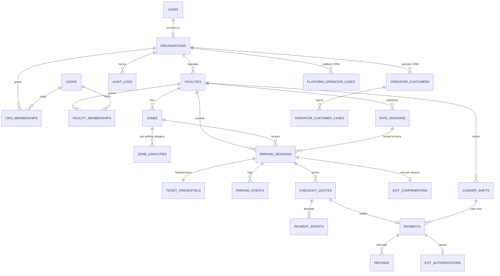

# Entity / relationship map (P0 planning artifact)

**Status:** Proposed. This is **not** a migration. The DB/Auth lead (P1 Session A) turns it into the Prisma schema and is the only migration author. Tables marked P2+ are designed by their phase owner and submitted to the DB lead for review.

| Entity | Tenant key(s) | Phase | Key constraints / notes |
|---|---|---|---|
| `users` | — (Supabase `auth.users.id`, no FK to the auth schema) | deferred | Not created in P1: memberships hold the auth user id directly. Add when staff names/invitations are needed. |
| `platform_memberships` | platform | ✅ P1 | `UNIQUE(user_id)`, role enum, `revoked_at` |
| `organizations` | self | P1 | `onboarding_status` (ADR CRM statuses), publish gated on approval |
| `org_memberships` | `organization_id` | P1 | `UNIQUE(organization_id, user_id)`, role enum, `revoked_at` |
| `facilities` | `organization_id` | P1 | `UNIQUE(id, organization_id)` for composite FKs; `visibility` public/private; `timezone` default Asia/Manila; PostGIS point (P2) |
| `facility_memberships` | `organization_id`, `facility_id` | P1 | composite FK → facilities; `UNIQUE(facility_id, user_id)` |
| `audit_logs` | `organization_id` (nullable for platform actions) | P1 | append-only (no UPDATE/DELETE grant) |
| `mobile_devices` | user-bound | P1 proposal | `revoked_at`, `installation_id_hash` |
| `zones`, `zone_capacities` | org + facility | P2 | capacity row = **lock owner** for check-in; `CHECK (usable >= 0)` |
| `rate_versions` | org + facility | P2 | immutable after publish; `rules_json` + `schema_version` |
| `parking_sessions` | org + facility | P2 | status enum (ADR-002), `entered_at` server default, `rate_snapshot`, `ticket_number` display-only |
| `ticket_credentials` | org + facility | P2 | `token_hash` (SHA-256/HMAC) `UNIQUE`; plaintext never stored |
| `parking_events` | org + facility | P2 | append-only, `source_occurred_at` for recovery |
| `idempotency_records` | org + user | P2 | `UNIQUE(user_id, action, key)`, `request_hash`, stored response |
| `checkout_quotes` | org + facility | P5 | amount centavos `bigint`, `expires_at`, `used_at` |
| `payment_intents`, `payments`, `refunds` | org + facility | P5 | provider event id `UNIQUE`; no hard deletes; one successful payment per quote |
| `exit_authorizations`, `exit_confirmations` | org + facility | P5 | `UNIQUE(session_id)` on confirmations |
| `cashier_shifts`, `cash_movements` | org + facility | P5 | one open shift per cashier per facility |
| `webhook_inbox` | — | P5 | `UNIQUE(provider, event_id)` |
| `mobile_sync_operations` | org + facility | P7 | `UNIQUE(device_id, operation_id)` (ADR-003) |
| `operator_customers`, `operator_customer_cases` (+ notes/events) | `organization_id` | P4/P6 | separate from platform CRM; no plate-as-identity |
| `leads`, `platform_operator_cases`, `account_activities`, onboarding checklist | platform | P6 | **no FK into driver/session tables** |

**No `balance` field anywhere** (no wallet). Money columns are `bigint` centavos.
