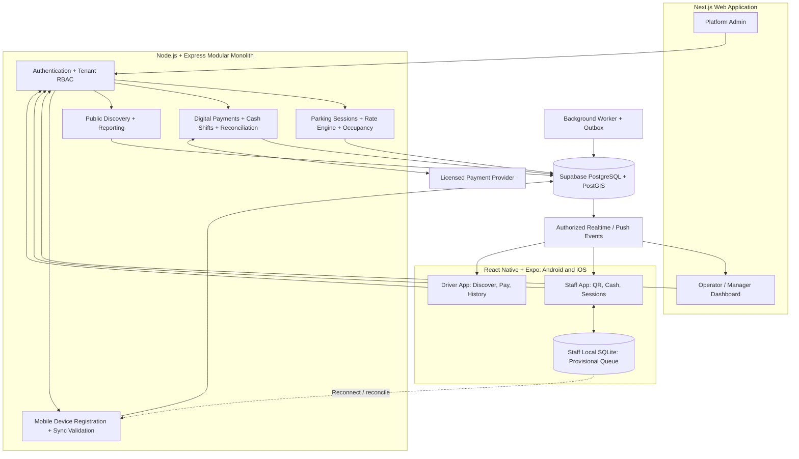
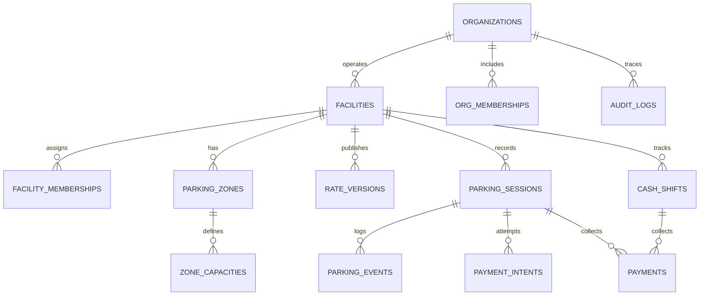

# Metro Manila Multi-Operator Parking Platform — MVP Blueprint v1.3 (React Native + CRM + Quiet Utility)

**Date:** 2026-11-04  
**Status:** Proposed, for operator discovery and technical review  
**Pilot:** Several facilities within one Metro Manila district  
**Mobile decision:** Separate React Native + Expo apps for **drivers** and **parking staff** on Android and iOS; **no PWA**
**Canonical design:** Instrument Sans 400/500 + DM Mono 300/400/500, accessible monochrome light/dark inversion, substantial 52–56px primary buttons.
**CRM scope:** Operator Customer CRM + Platform Admin Operator CRM (see `CRM_PRODUCT_SPEC.md`).
**Technical baseline:** Next.js, Node/Express, Supabase PostgreSQL, React Native, Tailwind CSS/NativeWind, and TanStack Query.  
**Web decision:** Next.js website for platform administrators and parking operators  
**Launch infrastructure:** Human attendants, paper tickets, inexpensive phones/tablets/computers; no mandatory gates or RFID  
**Parking operators:** All types supported through configurable facility rules  
**Payment methods:** Cash and licensed-provider digital payments from day one  
**Reservations and stored-value wallets:** Not in MVP  
**Revision note (original v1.1, retained context):** Replaces earlier PWA architecture with native React Native + Expo staff/driver apps; adds Expo EAS, mobile security, device registration and provisional offline sync design. The earlier companion SQL v1.0 has not yet been updated for proposed mobile tables.

## 1. Product thesis

Build a multi-tenant B2B parking operations system with **native iOS and Android apps** for drivers and staff, plus a **web-based operations portal** for parking operators and platform administrators. The platform manages organizations, multiple facilities, rate configuration, manual check-in/check-out, occupancy estimates, payment collection, and cashier reconciliation. Operators remain responsible for the physical facilities, their posted rates, their invoices, and their staff; the platform supplies software and integrates a permitted payment partner.

The product must not claim sensor-verified real-time parking inventory. With attendants manually recording movements, available spaces are **system-reported availability** plus a timestamp and data-freshness indicator.

## 2. Initial business assumptions and decisions

- One parking **organization** may own several **facilities**; a facility may have several **zones** and different vehicle-type capacities.
- All operator categories (independent lots, shopping centers, residential, commercial, hospital, etc.) share an operational core, while visibility, access rules, tax/invoicing configuration and policies differ by facility.
- Drivers do not need a permanent account or mobile-app installation to park. They get a tamper-resistant, opaque ticket locator; a native driver account is optional for saved history. Walk-ins must be supported with printed tickets and cash, and an optional normal hosted web checkout may be offered without building a PWA.
- The **React Native driver app** lists only facilities opting into public discovery; residential or employee-only facilities can be private.
- Drivers may pay online without having to preload money. Do not operate a custodial top-up wallet in MVP.
- Cash handling remains local to each operator and is reconciled by cashier shift.
- Before integrating a provider, confirm support for merchant onboarding, payment acceptance for multiple distinct operators, settlement routing, refunds, fees, KYC and your startup's legal role.

## 3. Application portfolio and ownership

| Application | Platform | Primary users | Required in MVP |
| --- | --- | --- | --- |
| **Platform and operator dashboard** | Next.js + TypeScript + Tailwind CSS (web) | Platform admin, organization owners, facility managers, auditors | Yes |
| **Staff mobile app** | React Native + Expo, Android and iOS | Attendants, cashiers, managers on duty | Yes; build first |
| **Driver mobile app** | React Native + Expo, Android and iOS | Drivers seeking facilities, viewing their ticket, and paying digitally | Yes; build after staff flow |
| **API and background worker** | Node.js + Express + TypeScript | All clients and server-side integrations | Yes |
| **Database** | Supabase PostgreSQL + PostGIS + Prisma | Central authoritative data | Yes |
| **Hosted payment checkout** | Licensed payment provider's hosted UI or approved SDK | Drivers paying a specific operator | Yes, subject to provider approval |
| **Printed-ticket / cash walk-in** | Operational fallback, no app installation | Unregistered drivers | Yes |

**Decision:** maintain two independently installable native apps because driver and staff permissions, UX, release cadence, and hardware capabilities differ. Share API clients, validation, design tokens, TypeScript contracts, and reusable React Native components in a monorepo. A single role-based app could reduce store-review overhead, but separate apps give clearer access boundaries and deployment policies.

**No PWA:** neither the driver app nor the staff app will be a progressive web app. A read-only public facility website or a one-time payment webpage is allowed; it does not replace the native applications.

## 4. Roles and access control

| Role | Privileges |
| --- | --- |
| Platform admin | Approve organizations, manage plans, inspect sanitized cross-tenant health; break-glass support with audit |
| Organization owner | Manage organization, facilities, staff access, finances |
| Facility manager | Configure facility and published rate versions, capacity, shifts and authorized adjustments |
| Attendant | Check in/out; read limited session data; cannot change rates or reverse payments |
| Cashier | Collect cash, initiate digital checkout, reconcile shift; cannot edit finalized payment records |
| Auditor | Read-only reports and audit exports |
| Driver | Read own authenticated sessions or securely claimed anonymous ticket |

**Authorization model:** authenticated user -> organization membership -> facility assignment -> permission. Every sensitive API query must enforce both organization and facility scope. Backend must verify signed Supabase tokens; never trust the organization_id in a request body on its own.

## 5. Functional requirements (MVP acceptance criteria)

### FR-01 Organization onboarding
- Create organization; store legal name, contact, business registration references, onboarding status.
- Create multiple facilities for a single organization.
- Restrict publishing until ownership and payment configuration are approved.
- **Acceptance:** User from operator A cannot read or mutate operator B's resources even with guessed UUIDs.

### FR-02 Facility details and discoverability
- Name, address, lat/long, operating hours, timezone Asia/Manila, facility type, public/private visibility, active/paused status, vehicle restrictions, entry instructions.
- Distinguish public discovery from private operations; hide private lots from search results.
- **Acceptance:** Public driver search returns approved and published facilities only.

### FR-03 Capacity and occupancy
- Configure facility zones (e.g. general, covered, resident-only) and capacity per class (car, motorcycle, large vehicle).
- Number of available *units* = usable capacity minus active allocated units, where closed/blocked capacity is already removed from usable capacity.
- An open parking session continues occupying capacity even if digitally paid; release only after departure is recorded.
- Use short database transactions and locks to prevent concurrent attendants overselling capacity.
- Manual reconciliation is supervisor-authorized and journaled; do not silently rewrite counters.
- **Acceptance:** 2 simultaneous requests for the last space cannot both succeed; dashboard shows last-updated timestamp and 'manual reporting' quality label.

### FR-04 Versioned rate plans
- Flat visit rate, first-N-hours fee, hourly/succeeding-hour rate and rounding, overnight surcharge, daily cap, grace period, configurable vehicle category, facility/zone-specific rate.
- Allow staff to simulate example durations before publishing a rate version.
- Immutable published rate version; sessions retain rate version and/or validated snapshot at entry.
- **Acceptance:** Historical invoices/charges do not change when owner edits future rate configuration.

### FR-05 Arrival and ticket issuance (React Native staff app)
- Attendant uses the native Android/iOS staff app, with large controls and Expo Camera QR scanning where appropriate, to select class, zone and optional plate, confirms entry; system generates unique human-readable ticket number plus high-entropy bearer token (store only hash of bearer token).
- Ticket works as paper printout, SMS link when independently consented, or QR displayed in the attendant device.
- One active session per physically parked vehicle is an operational rule with duplicate warnings; permit supervisor resolution of license-plate anomalies.
- **Acceptance:** Retry with identical idempotency key never creates a second session; session is attributed to staff, facility and server-side time.

### FR-06 In-session display
- The React Native driver app shows entered-at, duration, provisional charge, rate disclaimer and status for securely linked sessions. Staff can show the same values on the native staff app; unauthenticated customers may receive a printed ticket.
- Estimate is not authoritative until checkout quote/fee settlement.
- **Acceptance:** Running price equals the rate engine's deterministic computation for the same rule snapshot and time.

### FR-07 Checkout
- The React Native driver app requests checkout or the React Native attendant/cashier app initiates checkout. Backend creates server-authoritative price quote and captures the quote expiration policy.
- Cashier collects cash OR customer pays through a hosted payment session/QR; provider confirmation is verified server-side.
- Attendant confirms actual exit, including ticket and vehicle verification when applicable.
- **Acceptance:** No occupancy is released on 'paid' alone; fee and exit steps are independently recorded.

### FR-08 Cash payments
- A cashier with an open shift records tendered amount, change, successful collection timestamp and ticket reference.
- If a paper record is used during an outage, it must be reconciled and entered later with clear 'manual recovery' provenance.
- **Acceptance:** Daily cash totals and per-cashier expected drawer balances are reproducible without editing paid records.

### FR-09 Digital payments
- Payment intent is tied to a finalized/temporary quote, merchant facility, currency PHP and idempotency key.
- Return-page redirect is not proof of payment. Store verified signed webhook events; use idempotent event processing and provider status re-query for uncertain callbacks.
- Confirm payment credited to correct operator merchant account under a provider-approved configuration.
- **Acceptance:** duplicate webhook yields one recorded successful payment, not two.

### FR-10 Public parking discovery (React Native driver app)
- Use a map/list interface and device location with explicit permission; include address search if location is denied. Filter approved public facilities by search text, vicinity, vehicle class, operational status, rate category and reporting freshness.
- Show *reported* available capacity and timestamp. Show 'unavailable/unknown' when stale or offline, not a fabricated zero or an authoritative sensor claim.
- **Acceptance:** listings do not expose staff-only or private residential facilities.

### FR-11 Reporting and exceptions
- Facility and organization totals: sessions, occupancy trend, fee totals, cash paid, digital paid, refunds, adjustments, cashier shifts, discrepancies.
- Track missing ticket, no-exit, overcapacity, duplicate plate, void/refund, stale occupancy and webhook retries.
- **Acceptance:** Every fee adjustment and override records actor, timestamp and reason.

### FR-12 Privacy and audit
- Minimum necessary customer data. Keep sensitive driver and payment data out of native notification payloads and diagnostic logs. Avoid account requirement for walk-ins; never place sequential ticket IDs alone in public lookup endpoints.
- Audit privileged configuration, entry/exit overrides, refunds and PII views; set retention by contract and law.
- **Acceptance:** a non-privileged operator employee cannot see other facilities' revenue or drivers, and a guest cannot enumerate tickets.

### FR-13 Native application release and mobile lifecycle
- Publish and maintain **two native app identifiers** (driver and staff), separate environment configurations, and independently versioned Android/iOS release channels using Expo EAS Build and EAS Update where compatible.
- Use native development builds to test camera, push notifications, secure storage, deep links and potential hardware SDKs; do not rely on Expo Go as a production-runtime substitute.
- Never embed a payment-provider secret or Supabase service-role key in either app bundle. Revoke staff access on the server immediately after account deactivation.
- **Acceptance:** a revoked staff account cannot create check-ins or cash collections after API authorization is revoked, even if an old app build remains installed.

### FR-14 Staff offline tolerance and recovery
- Use **Expo SQLite** as a local, restricted, temporary queue for provisional check-in/exit observations and device sync metadata. Keep secrets in secure native storage and avoid unnecessary PII on device.
- Each queued record has a client-generated event UUID, device ID, facility assignment, captured time, local monotonic sequence, operator identity, and sync status.
- Reconnection sync validates signed-in staff membership, idempotency, timestamp differences and current server state; exceptions need manager review.
- **Offline entry/exit events do not immediately alter centralized occupancy**. Clearly mark them provisional. Offline cash is handled under a documented manual recovery and reconciliation policy; never approve digital payment offline or treat stale cached "paid" as final exit authorization.
- **Acceptance:** duplicate replayed device events cause at most one authoritative state change; rejected/ambiguous records remain visible for reconciliation and are never silently discarded.

### FR-15 Driver native experience
- Provide a map/list of nearby publicly listed lots, filters by vehicle type, fees and status, detailed lot hours/restrictions, and freshness of reported availability.
- Native app features: securely claim a current parking ticket, show running estimated fees, request provider-hosted digital payment, view verified payment status and history, optionally receive push notifications.
- GPS permission is optional and denial must not block manual search. No reservation feature in MVP.
- **Acceptance:** a driver without the mobile app can still park and pay cash using a printed ticket. App users can never access an unrelated guest's session by guessing an identifier.

## 6. Explicit non-MVP items

No preloaded wallet, consumer reservations, guaranteed assigned spaces, automatic recurring subscription billing, loyalty points, LPR/ANPR, RFID access, remote gate commands, per-bay sensors, automated demand prediction, or direct Easytrip/Autosweep integration. **Do not implement driver or staff PWAs**; React Native apps are part of the launch scope. Keep clean adapter interfaces for later.

## 7. Business rules and invariants

| ID | Rule |
| --- | --- |
| BR-01 | Every session belongs to exactly one facility, which belongs to one organization. |
| BR-02 | Entry time comes from trusted backend time except documented supervisor corrections. Persist UTC timestamps; show Asia/Manila local time. |
| BR-03 | Usable capacity is broken down by vehicle class and zone. No reservations means no ordinary booking holds. |
| BR-04 | Check-in is atomic: lock capacity row, verify remaining units, create session and ENTRY event in one transaction. |
| BR-05 | Published rate versions are immutable. Store a version pointer and serialized, validated rate snapshot for reproducibility. |
| BR-06 | Running amounts are indicative; charge is calculated by the server at checkout based on agreed rounding/grace/overnight rules. |
| BR-07 | Cash is marked paid only after authorized cashier records receipt; gateway charge only after trusted provider verification. |
| BR-08 | No split tender for MVP (one successful payment covers a session); any partial/failed payments remain visible for reconciliation. |
| BR-09 | Duplicate active checkout quotes can be avoided with a session lock and idempotency key; expired quote requires recalculation. |
| BR-10 | Post-payment exit grace (e.g., configurable 10–15 minutes) and additional-fee rules must be disclosed. Do not silently reopen a completed transaction. |
| BR-11 | Physical exit is separate from payment. Capacity is released upon confirmed departure, not on payment initiation or completion. |
| BR-12 | Refunds/voids use compensating records and approval; never hard-delete financial history. |
| BR-13 | Payment and webhook processing are idempotent; reconcile outstanding intents with the provider. |
| BR-14 | Only approved/public facilities appear in consumer search. Stale occupancy appears as 'unknown' or 'last reported', not guaranteed free. |
| BR-15 | Cash transactions belong to a cashier shift; cash reconciliation compares opening float + payments - refunds/disbursements to counted cash. |
| BR-16 | Exceptions (lost ticket, incomplete registration, unauthorized exit) require reason codes and manager approval when configured. |
| BR-17 | Consumer ticket tokens are opaque/high-entropy and hashed at rest; public endpoints are rate limited. |
| BR-18 | Store amounts in minor PHP currency units as integer bigint; do not calculate currency with float. |
| BR-19 | Use explicit status transitions; never infer session closure solely from payment success. |
| BR-20 | The legal seller/invoicing party for parking must be defined contractually for each facility; a parking ticket is not automatically a BIR-compliant invoice. |
| BR-21 | Staff-app cached occupancy and payment indicators are advisory only; the backend remains authoritative when online. |
| BR-22 | Offline staff submissions are provisional observations. Applying a replayed operation requires server-side authorization, validation, duplicate detection and reconciliation. |
| BR-23 | A lost or stolen staff device can be disabled by administrators without requiring an app release. |
| BR-24 | Driver location, push notification and camera permissions must be requested only when needed; denied permissions cannot prevent standard parking operations. |
| BR-25 | Neither a successful mobile payment redirect nor a push notification is proof of settlement; the verified provider transaction is authoritative. |

### Suggested session status transitions

`ACTIVE -> CHECKOUT_PENDING -> PAID_AWAITING_EXIT -> CLOSED`

Alternative paths: `CHECKOUT_PENDING -> ACTIVE` (abandoned quote), `ACTIVE -> CANCELLED` (supervisor approval for erroneous check-in), `CHECKOUT_PENDING -> EXCEPTION` (disputed, stranded, provider inconsistent). Cash and digital both reach `PAID_AWAITING_EXIT` only when valid payment is recorded. No unpaid departure in ordinary flow; exceptions are logged and reconciled.

### Rate engine rules

- Example plan: ₱50 first 2 hours, ₱20 each following **started** hour; configurable 15-minute free exit window; ₱150 overnight surcharge.
- Make the **entry grace**, **post-payment exit grace**, **ceiling/floor rounding**, **day rollover**, **maximum stay**, **daily cap**, **holiday schedule**, **effective clock timezone**, **overnight cutoffs**, **rate-change during session policy**, **tax-inclusive/tax-exclusive display** explicit.
- Avoid treating all 'long term' parking as hourly arithmetic: a prepaid monthly pass and daily maximum are different products; prepaid monthly passes require an eligibility registry before auto-renewal is attempted.
- Rate calculation should be a pure, versioned domain function: `(rateSnapshot, entryAt, billableThroughAt, vehicleClass, contextualFlags) -> chargeBreakdown`.
- Add test vectors for exactly 2 hours, 2h01m, zero duration, >24 hours, two calendar days, overnight boundary and paid-but-not-exited cases.

## 8. Operating workflows

**Check-in (staff native app)**: Staff signs into their assigned facility -> selects facility/zone/vehicle class -> scans/enters optional plate -> backend locks capacity -> session + event + secure ticket created -> printed or securely shown ticket given to driver -> occupancy broadcast to mobile clients and web dashboards.

**Cash checkout**: Staff retrieves ticket -> backend locks session -> server quote -> tender accepted and recorded with shift -> session paid-awaiting-exit -> attendant confirms actual departure -> close session and release capacity.

**Digital checkout (driver native app or supervised staff checkout)**: Driver opens securely claimed ticket in the app -> backend quote -> merchant-scoped payment intent -> approved PSP hosted checkout / QR Ph / native SDK -> verified signed webhook -> idempotent successful payment -> staff native app refreshes authoritative paid status -> confirms departure -> closes session and releases capacity. A one-time hosted browser checkout can support non-app users, but it is not a PWA.

**Offline / network outage**: Native staff app may retain minimal provisional observations in Expo SQLite; if device or printer is unusable, the lot uses a controlled numbered paper fallback book -> records are synced or transcribed with original time, staff, device or manual source, and shift -> backend validates conflicts and clock skew -> supervisor resolves exceptions -> reported availability is marked stale or unknown during prolonged disconnection. The system must not silently trust a disconnected cash payment, stale paid status, or unverified offline exit. This is **offline tolerance**, not guaranteed offline checkout or cloud-equivalent accuracy.

**Driver native app**: Driver opens React Native app -> permits GPS or searches manually -> selects public parking facility -> views reported occupancy and fee policy -> optionally claims an active ticket using a high-entropy token -> checks estimated charge -> initiates digital checkout -> waits for verified payment confirmation. Walk-in use without an app remains supported.

## 9. Architecture



### Technical choices

- **Web:** Next.js / TypeScript / Tailwind for operator, manager, auditor and platform administration. Maintain role-specific layouts and accessible data-dense reports.
- **Android and iOS:** two React Native + Expo apps, each using Expo Router, TanStack Query for server state, a small local state store, Expo SecureStore for session material, Expo Camera for QR scans, Expo Location and a supported native map package for driver discovery, Expo SQLite for staff provisional offline records, and Expo Notifications only for non-authoritative alerts. Use native development builds and EAS Build; test both OS releases independently.
- **Mobile app data:** short-lived cache, permission-aware location search, protected token deep links, supervised local operation queues, appropriate app sign-out and data wipe behavior on staff deprovisioning.
- **Backend:** Express.js + TypeScript + Zod; separate domain modules for tenants, facilities, capacity, rates, sessions, payments, reporting, audit.
- **Auth:** Supabase Auth; verify JWT server-side. Backend checks organization and facility membership, not only `role` from metadata.
- **Data:** PostgreSQL managed through Supabase, Prisma ORM, SQL migrations for indexes and complex constraints; PostGIS for nearby queries.
- **Payments:** provider adapter with per-merchant configuration, webhook verification, payout and reconciliation views.
- **Async:** transactional outbox + background worker for webhook retry, settlement reconciliation and occupancy broadcasts.
- **Realtime:** subscribe to small authorized per-facility capacity aggregates on web and native apps, not every parking session/PII row. Push notifications are hints, not a source of truth; clients refresh authoritative state from the API.
- **Hosting:** Vercel Next.js frontend, separately managed always-on Node API/worker, Supabase database. Keep region and latency under review.
- **Hardware-ready interface:** `AccessCredentialProvider`, `GateCommandAdapter`, `OccupancySource`, `VehicleIdentificationSource` — not implemented in MVP. Future long-range UHF RFID readers use dedicated vendor hardware/gateways rather than ordinary phone NFC.

### Monorepo layout

```text
parking-platform/
├── apps/
│   ├── web/                  # Next.js: platform admin, operator dashboard
│   ├── driver-mobile/        # Expo Router: native driver Android/iOS
│   ├── staff-mobile/         # Expo Router: native attendant/cashier Android/iOS
│   ├── api/                  # Node.js Express API
│   └── worker/               # Jobs, outbox, reconciliation
├── packages/
│   ├── database/             # Prisma schema, migrations, seed tools
│   ├── api-client/           # Typed clients for native and web
│   ├── contracts/            # Shared Zod schemas / DTOs
│   ├── pricing/              # Shared pure pricing tests and rule schema
│   ├── ui-mobile/            # Reusable React Native components/tokens
│   ├── ui-web/               # Web components, tokens and form patterns
│   └── config/               # TypeScript/ESLint/build configs
├── turbo.json
└── package.json
```

**Separation rule:** do not calculate authoritative pricing or payment outcomes on the mobile client. Client estimates and cached status may be displayed, but checkout, entry, exit and payment state transitions are server-controlled. Share validated contracts and deterministic test fixtures across the monorepo.

### Mobile permissions, release and resilience checklist

- **Android and iOS:** configure separate bundle/application IDs for driver and staff apps, correct app entitlements, deep links and environment-specific endpoints.
- **Expo development builds:** test native camera/QR, secure storage, maps, background-foreground restoration, app-link return from payment provider and notification permissions on actual iOS and Android devices. Expo Go alone is insufficient for release sign-off.
- **Distribution:** EAS Build for signed Android and iOS artifacts; production release through Google Play and Apple App Store or an approved managed staff-distribution channel. Operator devices can use restricted staff enrollment and organization-scoped provisioning.
- **Loss of network:** show online/offline status, local queue count, pending/accepted/rejected sync state and facility availability freshness. Do not promise autonomous gate operation or verified payment capture offline.
- **Security:** restrict locally cached driver PII; use SecureStore for secrets, protect logged-in staff session lifecycles, avoid secrets in app bundles, and permit remote session/token revocation.
- **Payment UX:** provider-hosted checkout/approved payment SDK must return users into the native app safely; the app then re-queries server-verified payment status. A browser redirect cannot itself mark the payment as paid.

### Nonfunctional targets (proposed, to confirm with operators)

- Check-in/check-out p95 API response under 1 second under normal pilot conditions, excluding third-party payment completion.
- Facility dashboard occupancy update visible within 5 seconds of server-confirmed entry or exit when online.
- Daily encrypted backups, tested restore process, security logging, service error monitoring, and documented recovery procedures.
- Server-side authorization tests; least-privilege credentials; secrets outside frontend bundles.
- Payment processing resilient to replayed callbacks, network timeouts and delayed status confirmations.
- Financial and operational timelines are auditable; no hard deletion of payment records.

## 10. Database domains and entity relationships

See companion `metro_manila_parking_initial_schema.sql` for the **core v1.0 PostgreSQL starting point**. The additional mobile tables listed below are **v1.1 design changes** to add in a later migration; the original SQL companion has not yet been migrated for them.



### Key schema conventions

- UUID primary keys; canonical `organization_id` in every tenant-owned record; composite foreign keys that prevent cross-facility association.
- Use DB-managed `timestamptz`, not client clocks, for event ordering; preserve `source_occurred_at` separately for approved outage recovery.
- Never store provider API secret in the database; store provider merchant reference IDs and encrypted configuration references.
- Rate version contains validated immutable `rules_json` and `schema_version`; session stores `rate_snapshot` to preserve charging semantics.
- Session `ticket_token_hash` is private and not the same as human-readable ticket number.
- Payment intents and successful recorded payments are separate; provider webhook event IDs have unique constraint.
- Index open sessions by facility/zone/vehicle class for occupancy calculations; index active sessions and cash shift status.
- Private details should not be exposed via Supabase public APIs. Use server-only DB access or meticulously tested RLS policies.

### Additional mobile persistence (proposed v1.1 schema delta)

| Table | Example fields | Purpose |
| --- | --- | --- |
| `mobile_devices` | `id`, `user_id`, `app_kind`, `platform`, `installation_id_hash`, `revoked_at`, `last_seen_at` | Device registration and staff device revocation |
| `mobile_sync_operations` | `id`, `device_id`, `facility_id`, `actor_id`, `operation_id`, `operation_type`, `client_occurred_at`, `received_at`, `payload_json`, `status`, `rejection_reason` | Provisional staff offline observations, deduplication, adjudication and replay trace |
| `notification_tokens` | `id`, `device_id`, `provider`, `token_encrypted`, `enabled`, `last_registered_at` | Push token lifecycle and opt-out |

**Required constraints:** `UNIQUE(device_id, operation_id)` for deduplication; server-side facility membership verification; allowlist operation types; limited payload retention; index queued operations by `facility_id` and `status`; protect notification tokens; never save raw mobile auth tokens or payment secrets in these tables. Server-generated parking event timestamps remain authoritative, with original offline-observed times recorded separately for supervisor reconciliation.

**Do not add a generic `balance` field to drivers:** the MVP has no custodial wallet.

## 11. API sketch

| Method | Route | Purpose |
| --- | --- | --- |
| `POST` | `/v1/organizations` | Create operator organization |
| `POST` | `/v1/facilities` | Create operator facility |
| `PATCH` | `/v1/facilities/:id` | Update facility config |
| `GET` | `/v1/public/facilities?near=...` | List public verified facilities |
| `GET` | `/v1/facilities/:id/occupancy` | Scoped occupancy aggregate |
| `POST` | `/v1/facilities/:id/check-ins` | Atomic entry + ticket issue |
| `GET` | `/v1/sessions/:id` | Restricted session details |
| `POST` | `/v1/sessions/:id/checkout-quote` | Generate checkout amount |
| `POST` | `/v1/sessions/:id/payment-intents` | Create provider payment request |
| `POST` | `/v1/sessions/:id/cash-payments` | Cashier records received cash |
| `POST` | `/v1/sessions/:id/exit` | Confirm departure and release capacity |
| `POST` | `/v1/cash-shifts/open` | Start cashier shift |
| `POST` | `/v1/cash-shifts/:id/close` | Close and reconcile shift |
| `POST` | `/v1/webhooks/payments/:provider` | Verify and ingest provider event |
| `POST` | `/v1/mobile/devices` | Register an authorized staff or driver installation |
| `DELETE` | `/v1/mobile/devices/:id` | Revoke a registered installation |
| `POST` | `/v1/mobile/staff/sync-operations` | Submit batched **provisional** device operations for idempotent server validation |
| `GET` | `/v1/mobile/staff/sync-operations/:id` | Read accepted/rejected/pending operation status |
| `POST` | `/v1/mobile/notifications/token` | Register a scoped push token, if user opted in |
| `GET` | `/v1/drivers/me/sessions` | List authorized driver-linked parking sessions |

Use standard `Idempotency-Key` for entry, exit and financial mutation endpoints; bind idempotency records to user, organization, action and request hash. Anonymous ticket lookup should not allow plate-number guessing or ticket enumeration.

## 12. Threats and operational edge cases

- Attendant forgets entry or exit -> reported occupancy differs from actual -> supervised reconciliation with full event trail.
- Two attendants admit the final vehicle simultaneously -> lock the zone/class capacity row and serialize check-in.
- Customer pays digitally but closes the app -> webhook is system-of-record; polling only supplements verified provider state.
- Digital payment expires while visitor is parked -> recalculate quote and create new intent; old intent cannot settle a newly priced checkout unnoticed.
- Payment succeeds twice -> retain both provider records, flag overpayment, freeze automatic second acceptance, refund through authorized workflow; do not delete evidence.
- Client clock is wrong -> server time authoritative.
- Cashier modifies historical payment -> prohibit updates; create reversal/adjustment entries.
- Vehicle pays but stays beyond exit grace -> calculate additional fee from policy, retain original paid payment.
- Lot is full but driver sees an available space -> freshness label and `subject to confirmation` notice; manual entry source can be imperfect.
- Concurrent facility manager publishes overlapping rates -> unique/transactional controlled publishing and overlapping-window validation.
- Driver has no mobile phone -> staff paper ticket and cash payment continue to work.
- Internet outage -> staff app may queue limited provisional records in Expo SQLite; paper tickets and controlled manual ledger remain operational fallback. Backend applies accepted operations only after replay validation and conflict resolution. Do not guarantee offline payment authorization or synchronized capacity.
- Lost staff phone -> manager revokes device, server session and facility assignment; any unsynced local records require separate manager reconciliation.
- Driver denies GPS -> manual address search remains usable; do not require background location.
- Checkout returns from payment provider without webhook -> show `processing`, query backend and reconcile with provider; do not mark paid from redirect alone.
- Stale installed app release -> version and permission controls; force minimum compatible version only when a breaking safety or security change requires it.

## 13. Regulatory and commercial gates (Philippines)

1. **BSP/payment role:** BSP Circular 1198 covers merchant payment acceptance; confirm whether startup itself performs an OPS/merchant-acquisition activity. A licensed payment partner with merchant subaccounts is promising but does not automatically settle legal classification.
2. **Merchant onboarding/settlement:** confirm legal payee, who holds funds, settlement schedule, KYC/KYB, refunds, payment fees and operator disputes. Xendit documentation describes subaccounts and split payments, but product eligibility and Philippine terms require confirmation.
3. **BIR:** Determine which operator issues the invoice, POS/CRM registration obligations, correct invoice format, and platform SaaS invoicing separately. EOPT changes mean a parking stub is not automatically a tax invoice.
4. **NPC:** Establish privacy roles between operator and platform, retention policy, public ticket access control, privacy notice, incident response, potential DPO/data-system registration, and PIA; add CCTV/ANPR rules later.
5. **LGU/landlord:** verify facility authority, rates, visitor restrictions, mandatory slots, traffic management and building rules for each operator category.
6. **Contracts:** data ownership, payment responsibility, staff operational discipline, support SLA, data exports, cancellations, terms of service, liability for inaccurate occupancy and network outages.

**Primary references:**
- BSP payments oversight: https://www.bsp.gov.ph/SitePages/PaymentsAndSettlements/PaymentsAndSettlements.aspx
- BSP Circular 1198 FAQ: https://www.bsp.gov.ph/Regulations/Issuances/2024/1198%20-%20FAQ.pdf
- Xendit subaccounts: https://docs.xendit.co/v1/docs/sub-accounts
- Xendit splits: https://docs.xendit.co/docs/split-payments
- BIR RMC 77-2024: https://bir-cdn.bir.gov.ph/BIR/pdf/RMC%20No.%2077-2024.pdf
- NPC registration FAQ updated 2026: https://privacy.gov.ph/pips-and-pics/faqs/

## 14. Pilot execution and measurable success

### Pre-build discovery (10 operating interviews; several facilities in one district)
- Observe entry, exit, payment, cash shift closing, missing tickets and overstay rules.
- Record vehicle classes, capacities and manual counters. Check staff Android/iOS device availability, camera support, internet reliability, battery/charger, receipt printers, and app-store or managed-app distribution constraints.
- Get operator rate cards and invoice/POS workflow reviewed by a qualified local tax adviser.
- Confirm preferred PSP's merchant configuration and agreement before coding settlement.

### Sprint order

1. Auth, tenant isolation, organizations/facilities, per-facility role assignment.
2. Capacity by zone/class, rate-version data model, pure rate engine + test vectors.
3. Atomic check-in/out, ticket generation, active sessions, occupancy freshness; implement React Native **staff app** QR scanning and restricted staff sessions.
4. React Native staff cashier flows: cash shifts, cash payments, audit trail, revenue reports, and safe offline provisional record reconciliation.
5. Digital PSP adapter, signed webhooks, idempotency, refunds/reconciliation.
6. React Native **driver app** for Android/iOS: facility discovery/map, secure active ticket, fee estimate, provider checkout and verified status; privacy and accessibility review.
7. Android and iOS development builds / EAS release candidate tests; two+ facility simulated load/failure tests, on-site staff training, native app publication/distribution, pilot release.

### Proposed pilot KPIs

- >=99% session closure/accounting completeness after exception reconciliation.
- 0 unexplained duplicate successful payment records from webhook retries.
- 100% of cash payments attributable to a cashier and shift.
- 100% of rate changes versioned and signed to an authorized actor.
- Capacity discrepancies measured daily against a manual headcount, with explicit targets set after baseline observation.
- Checkout time and staff training burden tracked at every facility.

## 15. Native mobile screen inventory (MVP)

### Staff app (React Native + Expo)

| Screen | Key actions |
| --- | --- |
| Sign in / select facility | Authenticate, choose permitted facility, display current shift |
| Operations home | Active sessions, currently reported occupancy, quick actions, offline indicator |
| Vehicle entry | Vehicle class, zone, optional plate, fee rules, confirm entry, QR/ticket |
| Ticket lookup / QR scan | Camera scan, ticket code search, safe plate lookup with staff permissions |
| Session detail | Entry time, current elapsed time, provisional fee, payment and exit status |
| Checkout | Request server quote, choose cash or digital, confirm payment status |
| Physical exit | Verify ticket and vehicle, confirm departure, release capacity on server |
| Cashier shift | Start shift, record collections, counted cash, end shift, discrepancies |
| Sync and exceptions | Local provisional event list, replay results, conflict reports, manager review |
| Profile and device | Facility assignment, permission summary, sign out, device status |

**Design requirements:** large touch targets, minimal data entry, high contrast, reliable status indicators, glove-friendly controls, fast search, clear error recovery, and explicit confirmation before money or occupancy changes. Never present cached payment state as verified.

### Driver app (React Native + Expo)

| Screen | Key actions |
| --- | --- |
| Discover | Map/list of permitted facilities, search and filters, availability freshness |
| Facility detail | Rates, vehicle types, hours, directions, facility restrictions, reported capacity |
| My parking | Securely linked active ticket, entry time, estimated fee, payment state |
| Checkout | Server-generated quote, approved PSP flow, pending/paid status |
| History | Paid sessions and payment references for linked sessions |
| Profile | Saved vehicle details (optional), notification preferences, session security |

**Design requirements:** iOS and Android native navigation expectations, readable Philippine peso pricing, accessibility, clear fee breakdown, no requirement for GPS access, and no requirement that every parking customer install the app.

---

## 16. Open issues that affect financial/legal design

- Pick pilot district and willing operators; collect specific rate cards.
- Which entity is the legal merchant and invoice issuer for each parking payment?
- Does the PSP approve a genuine multi-merchant subaccount/settlement integration for your business?
- Should public availability be visible for privately gated, condominium or tenant-only facilities?
- What are the exact rounding, overnight and post-payment grace rules per facility?
- How much offline tolerance is required at every physical site, and which offline operations may be queued provisionally?
- Will staff apps be distributed publicly, through managed enterprise/device enrollment, or via controlled invitation and normal stores?
- Do you require physical thermal receipt printer support at launch (Bluetooth, Wi-Fi, or USB), and if so which exact manufacturer SDKs?
- How will non-app drivers receive or retrieve their ticket, and what secure one-time checkout fallback is acceptable?

**Architecture recommendation:** deliver **Next.js web administration + separate React Native/Expo driver and staff Android/iOS apps + one Express modular monolith + Supabase PostgreSQL**. Ship a configurable, multi-tenant, hardware-independent operations platform first. Build and test the native staff app before the driver app; do not implement your own prepaid wallet, automatic RFID gates or reservation engine until the pilot proves operational accuracy and required agreements are in place.


## v1.3 Addendum — superseding decisions

- The canonical technical specification, role boundaries and development order are in [`../README.md`](../README.md).
- Primary font: **Instrument Sans** regular and medium. Selectively use **DM Mono** for IDs, amounts and timestamps (the chosen technical typeface). See [`DESIGN_SYSTEM.md`](DESIGN_SYSTEM.md).
- Support two CRM surfaces in MVP, with service-focused operator customer records and separately permissioned platform account/onboarding records. See [`CRM_PRODUCT_SPEC.md`](CRM_PRODUCT_SPEC.md).
- Design both native apps for Android and iOS with platform-appropriate navigation, dialogs and selectors; preserve shared logic, TanStack Query and semantic tokens.
- The linked SQL schemas are **review-only starting points**. Validate the relationships and apply a single migration strategy before running on real data.
